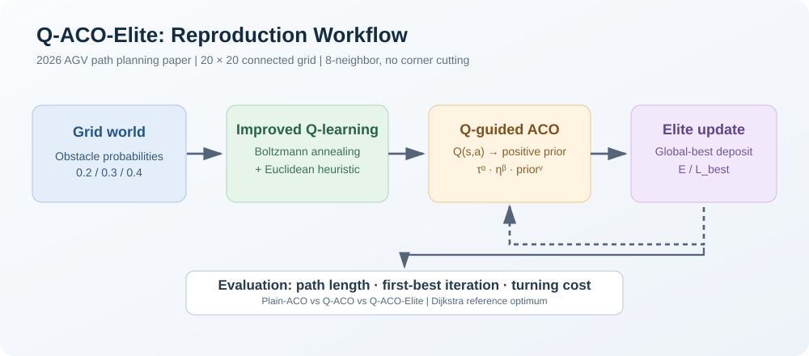
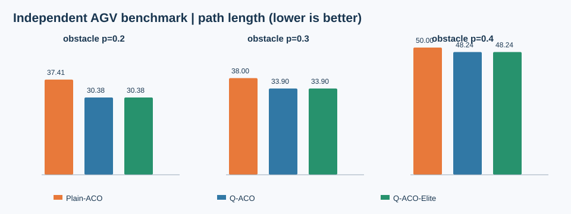
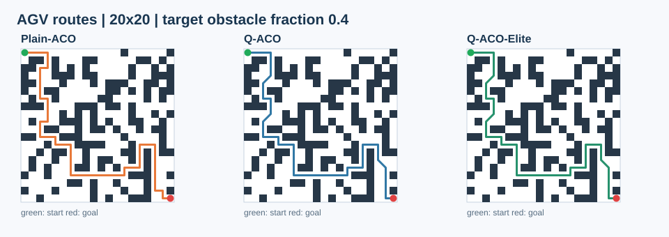
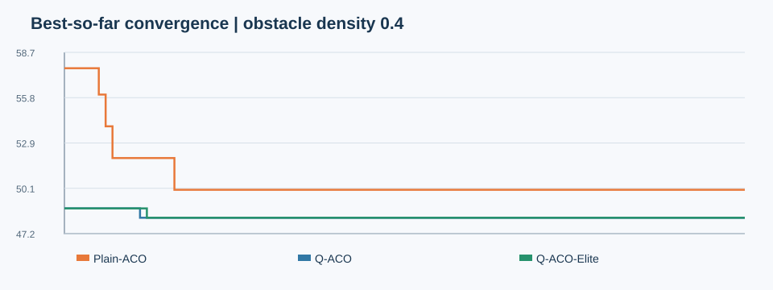

# QACO-Elite-Repro

[中文](#中文说明) | [English](#english)

**Reproduction of the 2026 paper "融合改进 Q 学习和蚁群算法的 AGV 路径规划"**, by 刘炀、吴艺茹、张恒, *组合机床与自动化加工技术*, 2026(9):161–166. DOI: [10.13462/j.cnki.mmtamt.2026.09.024](https://doi.org/10.13462/j.cnki.mmtamt.2026.09.024).



## 中文说明

### 研究目的

以论文提出的 **Q-ACO-Elite** 为基准，实现并验证改进 Q-learning、Q 值引导蚁群搜索和精英信息素强化的协同作用。严格区分**论文报告值**和**本仓库重新运行的实验值**；记录不可确定的实施细节，不臆造原始随机地图和训练随机种子。

### 三种比较算法

- **Plain-ACO**：信息素与一步距离启发信息，按论文式 (3)–(8) 搜索。
- **Q-ACO**：改进 Q-learning + Q 值引导的转移概率，按式 (9)–(15)。
- **Q-ACO-Elite**：在 Q-ACO 基础上加入历史全局最优路径的精英强化，按式 (16)–(17)。

Q-learning 使用随轮数衰减的 Boltzmann 温度、距离启发项与论文给定奖励（正常一步 −1、越界/碰撞 −10、到达目标 +10）。栅格为 **20×20，八邻域移动且禁止斜向穿角**。

### 关键公式

Q-learning：

$$Q(s,a) \leftarrow Q(s,a)+\alpha_1\left[r+\gamma\left(\max_{a'}Q(s',a')+\lambda\hat h(s')\right)-Q(s,a)\right]$$

Boltzmann 探索：

$$P(a\mid s)=\frac{\exp(Q(s,a)/T_t)}{\sum_{b\in A(s)}\exp(Q(s,b)/T_t)},\quad T_t=\max(T_{\min},T_0e^{-kt})$$

融合蚁群算法：

$$P_{ij}^k=\frac{\tau_{ij}^{\alpha}\eta_{ij}^{\beta}\widetilde Q_{ij}^{\nu}}{\sum_{l\in\mathrm{allowed}_k}\tau_{il}^{\alpha}\eta_{il}^{\beta}\widetilde Q_{il}^{\nu}}$$

$$\tau_{ij}(t+1)=(1-\rho)\tau_{ij}(t)+\sum_{k=1}^{m}\Delta\tau^k_{ij}(t)+E\Delta\tau_{ij}^{\mathrm{elite}}(t)$$

其中 `\widetilde Q` 是本仓库为消除负 Q 值歧义而使用的**逐状态正值归一化 Q 先验**，不是论文原文明确指定的公式。详情见 [复现边界](docs/reproduction_notes.md)。

### 本仓库真实运行结果（seed=2026）

**实验参数**：20×20 新生成的连通随机地图；目标障碍物概率分别 0.2/0.3/0.4；每地图 1200 个 Q 训练回合、50 只蚂蚁、100 次蚁群迭代。数值是**独立复现结果，不能当作论文原始结果**。

| 密度参数 | 算法 | 本次路径长度 | 最佳值首次出现轮次 | 转角代价 | 相对 Dijkstra 最优解差距 |
|---|---|---:|---:|---:|---:|
| 0.2 | Plain-ACO | 37.41 | 15 | 26 | 23.13% |
| 0.2 | Q-ACO | 30.38 | 6 | 15 | 0.00% |
| 0.2 | Q-ACO-Elite | 30.38 | 2 | 17 | 0.00% |
| 0.3 | Plain-ACO | 38.00 | 11 | 36 | 12.10% |
| 0.3 | Q-ACO | 33.90 | 1 | 24 | 0.00% |
| 0.3 | Q-ACO-Elite | 33.90 | 1 | 24 | 0.00% |
| 0.4 | Plain-ACO | 50.00 | 17 | 40 | 3.64% |
| 0.4 | Q-ACO | 48.24 | 12 | 34 | 0.00% |
| 0.4 | Q-ACO-Elite | 48.24 | 13 | 34 | 0.00% |







该**单种子**实验中，Q 引导优于 Plain-ACO，但精英策略没有进一步缩短最佳路径；0.2 地图的转角代价还略高于 Q-ACO。单种子结果**不足以证明**精英策略普遍有效或无效。图表均来自本仓库的真实计算数据。

### 本地安装与运行

```bash
python -m pip install -e '.[test]'
python -m pytest -q
python -m qaco_elite.experiment --output results --seed 2026 --q-episodes 1200 --ants 50 --iterations 100 --walk-cap 1800
python scripts/render_svg_results.py
```

输出 `results/results.csv`、`run_config.json`、三份地图 `.npy`、三份 Q 表 `.npy`、逐轮轨迹记录和 PNG 图片；SVG 可由上述脚本依据这些数据重新生成。

### 复现限制及下一步

论文没有提供原始地图文件、随机种子、Q-learning 训练回合数、初始信息素具体值、Q 值非负映射和死锁回退流程，因此当前属于**算法结构与实验设置复现**，而非论文原结果的逐点精确复现。下一阶段建议做多地图 × 多随机种子重复实验、消融研究、置信区间和与 Dijkstra 最优路径的差距分析。

## English

A transparent Python reproduction of **Q-ACO-Elite**, comparing Plain ACO, Q-guided ACO, and Q-guided ACO with global-best elite pheromone reinforcement on 20×20 obstacle grids. The project uses legal eight-neighbour transitions without corner cutting and reports path length, first-best iteration, and turning cost.

**How to run:** install with `pip install -e '.[test]'`, check with `pytest -q`, then execute the benchmark command shown above. Read `docs/reproduction_notes.md` for the assumptions where the paper is underspecified.

**Important:** The numerical results and maps provided here are **new independent simulations**, not the original authors' unreleased datasets or seeds. In the initial one-seed comparison the Q-guided methods found shorter paths than Plain-ACO, but elite reinforcement did not consistently improve the final path. No statistical superiority claim is made from this trial.

## License

MIT. The cited publication remains the intellectual work of its authors and is not redistributed in this repository.
